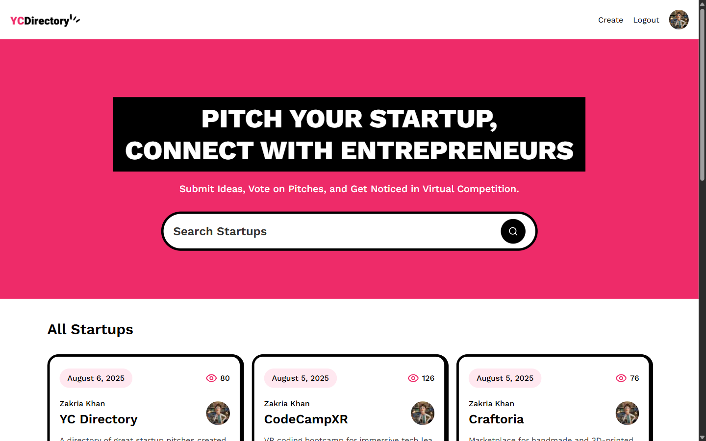
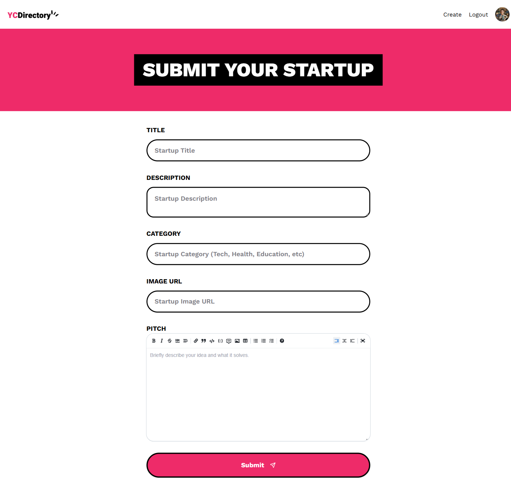
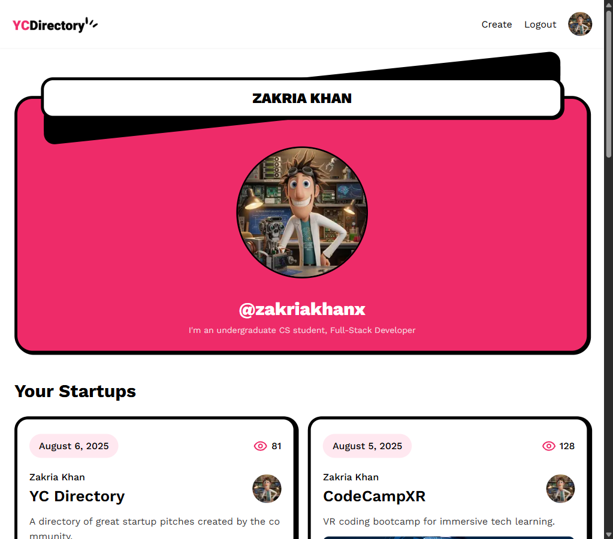
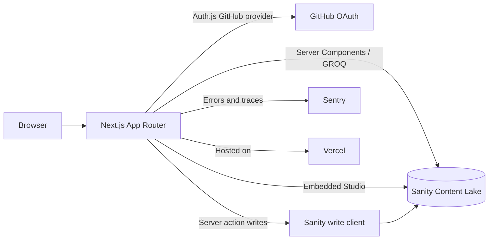

# YC Directory

[](https://github.com/zakriayousafzai/YC_Directory/actions/workflows/ci.yml)

A full-stack directory for publishing and discovering startup pitches. Built
with the Next.js App Router, Sanity, Auth.js, and Tailwind CSS.

[Live demo](https://yc-directory-nine-lilac.vercel.app) ·
[Known issues](docs/KNOWN_ISSUES.md) ·
[Deployment guide](docs/DEPLOYMENT.md) ·
[Contributing](CONTRIBUTING.md) ·
[Security](SECURITY.md)



> **Project status:** portfolio project. The latest pass added documentation,
> tests, metadata, dependency patches, and CI without changing application
> source. The app is not
> production-hardened; the remaining defects and dependency advisories are
> documented rather than hidden. See [Known issues](docs/KNOWN_ISSUES.md).

## Demo

The existing deployment is available at
<https://yc-directory-nine-lilac.vercel.app>.

The screenshots in this README were captured from a local production build of
this repository while signed in with GitHub. They show the current UI, including
the legacy "Vote on Pitches" copy; the application does not implement voting.


*The detail page renders the pitch as Markdown, shows the author, and displays a
view count.*

### Signed-in views

The header shows **Create**, **Logout**, and the GitHub avatar when a session is
active. `/startup/create` redirects signed-out visitors to the home page.



*The create form includes title, description, category, image URL, and a
Markdown pitch editor.*



*The profile page shows the signed-in author's GitHub avatar, handle, bio, and
startups, using the responsive stacked layout at a 1023px viewport.*

## Features

- **Browse a startup directory** with cards for the latest pitches.
- **Search** by title, category, or author name through a Sanity GROQ query.
  The current query has a precedence bug; see
  [Known issues](docs/KNOWN_ISSUES.md#3-search-query-precedence-bug).
- **Sign in with GitHub** through Auth.js v5. A Sanity `author` document is
  created on first sign-in.
- **Create a pitch** with a Markdown editor, auto-generated slug, category, and
  image URL.
- **Read pitch details** with Markdown rendering, author information, editor
  picks, and a view counter.
- **View author profiles** and their submitted startups.
- **Manage content** in the embedded Sanity Studio at `/studio`.
- **Live content** through Sanity's Live Content API and `SanityLive`.
- **Error monitoring** configured with Sentry.
- **Unit tests** for validation, utilities, Markdown safety, and the pitch
  server action.

There is **no voting feature** and no vote data model. The homepage copy is a
known documentation/UI mismatch.

## Tech stack

| Layer | Technology | Version in this repo |
| --- | --- | --- |
| Framework | [Next.js](https://nextjs.org/) App Router | `15.4.2-canary.29` |
| UI runtime | [React](https://react.dev/) | `19.1.0` |
| Language | [TypeScript](https://www.typescriptlang.org/) | `5.8.3` |
| Styling | [Tailwind CSS](https://tailwindcss.com/) | `3.4.17` |
| CMS | [Sanity](https://www.sanity.io/) | `4.1.1` |
| CMS integration | [`next-sanity`](https://github.com/sanity-io/next-sanity) | `10.1.0-canary.3` |
| Authentication | [Auth.js](https://authjs.dev/) (`next-auth`) | `5.0.0-beta.32` |
| Markdown | [`markdown-it`](https://github.com/markdown-it/markdown-it) | `14.3.3` |
| Error monitoring | [Sentry](https://sentry.io/) for Next.js | `10.76.2` |
| Tests | [Vitest](https://vitest.dev/) | `5.0.5` |
| Runtime | Node.js | 24 (`.nvmrc`; engines `>=20.9.0`) |

The canary, beta, and experimental versions are intentional for this project,
but they increase upgrade risk. See
[Known issues](docs/KNOWN_ISSUES.md#20-experimental-framework-features).

## Architecture



- **Reads:** Server Components use `sanityFetch` or the Sanity client.
- **Writes:** `createPitch` runs as a server action with the server-only Sanity
  write client.
- **Auth:** Auth.js uses the GitHub provider. The JWT/session carries the Sanity
  author `_id`.
- **Views:** `components/View.tsx` reads a count and patches it inside
  `after()`. The increment is not atomic; see
  [Known issues](docs/KNOWN_ISSUES.md#9-view-counter-is-racy-and-can-become-nan).
- **Observability:** Sentry is initialized through `instrumentation.ts` and the
  `sentry.*.config.ts` files.

## Quickstart

### Prerequisites

- Node.js 24 (or any version allowed by `engines`: `>=20.9.0`).
- npm (the repository uses `package-lock.json`).
- A Sanity project and dataset.
- A GitHub OAuth app.

### 1. Clone and install

```bash
git clone https://github.com/zakriayousafzai/YC_Directory.git
cd YC_Directory
npm ci
```

### 2. Configure environment variables

```bash
cp .env.example .env.local
```

On PowerShell:

```powershell
Copy-Item .env.example .env.local
```

Fill in the values described in [Environment variables](#environment-variables).
Never commit `.env` or `.env.local`.

### 3. Configure Sanity

1. Make the dataset publicly readable. The app does not use a read token.
2. Add CORS origins for `http://localhost:3000` and your deployed origin.
3. Create an **Editor** token and set `SANITY_WRITE_TOKEN`.
4. Create a playlist with slug `editor-picks`. Startup detail pages currently
   fail if this document is missing.
5. Optionally add sample startups. The first GitHub sign-in creates the author.

### 4. Configure GitHub OAuth

Create a GitHub OAuth app with:

- Homepage URL: `http://localhost:3000`
- Authorization callback URL:
  `http://localhost:3000/api/auth/callback/github`

Set `AUTH_GITHUB_ID` and `AUTH_GITHUB_SECRET`. Generate `AUTH_SECRET` with
`openssl rand -base64 32` or the Node command in `.env.example`.

### 5. Run the app

```bash
npm run dev
```

`npm run dev` automatically runs `npm run typegen` first. Open
<http://localhost:3000>. The Sanity Studio is at
<http://localhost:3000/studio>.

For a production build locally:

```bash
npm run build
npm start
```

## Environment variables

| Variable | Required | Exposure | Description |
| --- | --- | --- | --- |
| `NEXT_PUBLIC_SANITY_PROJECT_ID` | Yes | Public | Sanity project ID |
| `NEXT_PUBLIC_SANITY_DATASET` | Yes | Public | Sanity dataset name |
| `NEXT_PUBLIC_SANITY_API_VERSION` | No | Public | Defaults to `2025-07-25` |
| `SANITY_WRITE_TOKEN` | Yes for writes | Server-only | Sanity Editor token for author creation, pitch creation, and view updates |
| `AUTH_SECRET` | Yes | Server-only | Auth.js session encryption secret |
| `AUTH_GITHUB_ID` | Yes | Server-side | GitHub OAuth client ID |
| `AUTH_GITHUB_SECRET` | Yes | Server-only | GitHub OAuth client secret |
| `SENTRY_AUTH_TOKEN` | No | Build-only | Uploads source maps during the build; omit locally |

The repository does **not** use `SANITY_API_READ_TOKEN` or
`SANITY_API_WRITE_TOKEN`. Use the names above.

See [`.env.example`](.env.example) for safe placeholders and setup comments.

## Scripts

| Command | Purpose |
| --- | --- |
| `npm run dev` | Start the development server (runs typegen first) |
| `npm run build` | Production build (runs typegen first) |
| `npm start` | Serve the production build |
| `npm run lint` | ESLint via `next lint` |
| `npm test` | Run the Vitest suite once |
| `npm run test:watch` | Run Vitest in watch mode |
| `npm run typecheck` | Run `tsc --noEmit` |
| `npm run typegen` | Extract the Sanity schema and generate TypeScript types |
| `npm run predev` / `npm run prebuild` | Automatic typegen hooks |

### Current check status

Verified on 2026-10-27 with Node 24.13.0 and npm 11.21.1:

| Command | Result |
| --- | --- |
| `npm test` | **Pass** — 4 files, 19 tests |
| `npm run build` | **Pass** — type and lint checks are disabled in `next.config.ts` |
| `npm run lint` | **Fail** — 4 errors, 3 warnings |
| `npm run typecheck` | **Fail** — 12 errors in `auth.ts` |

`npm run build` above was run with a real Sanity environment. CI cannot receive
that access, so it runs `npm run build --ignore-scripts` with placeholder
values. That variant was verified in a clean copy (381.7 seconds, 4 GB heap).

This is why CI gates on tests and the build, while lint and typecheck are
reported as informational. The full list is in
[Known issues](docs/KNOWN_ISSUES.md).

## Project structure

```text
app/
  (root)/                 Public directory, startup detail, create, user profile
  api/auth/[...nextauth]/ Auth.js route handler
  api/sentry-example-api/ Diagnostic route (should be removed in production)
  studio/[[...tool]]/     Embedded Sanity Studio
  sentry-example-page/    Diagnostic page
components/               Navbar, search, cards, form, UI primitives
lib/
  action.ts               createPitch server action
  queries.ts              GROQ queries
  utils.ts                cn, date formatting, response cloning
  validation.ts           Zod form schema with image HEAD check
sanity/
  lib/                    Read client, write client, live content
  schemaTypes/            author, startup, playlist schemas
tests/                    Vitest unit tests
docs/                     Deployment guide, known issues, screenshots
auth.ts                   Auth.js configuration
next.config.ts            Next.js, image, and Sentry configuration
```

## Routes

| Route | Access | Purpose |
| --- | --- | --- |
| `/` | Public | Startup directory and search |
| `/startup/[id]` | Public | Startup detail and pitch |
| `/startup/create` | Signed-in users | Submit a startup (redirects to `/` when signed out) |
| `/user/[id]` | Public | Author profile and their startups |
| `/studio/[[...tool]]` | Public shell, Sanity-authenticated editing | Embedded Sanity Studio |
| `/api/auth/[...nextauth]` | Public | Auth.js route handler |
| `/sentry-example-page` | Public | Sentry diagnostic page |
| `/api/sentry-example-api` | Public | Sentry diagnostic API that intentionally throws |

## Testing

```bash
npm test
npm run test:watch
```

The suite covers:

- `tests/validation.test.ts` — valid and invalid pitch payloads, image
  `content-type` checks, missing headers, and network failures.
- `tests/utils.test.ts` — `cn`, `formateDate`, and
  `parseServerActionResponse`.
- `tests/markdown.test.ts` — default Markdown rendering, raw HTML escaping, and
  blocked `javascript:` links.
- `tests/action.test.ts` — unauthenticated rejection and the authenticated write
  payload with mocked `@/auth` and `@/sanity/lib/write-client`.

Not covered: GitHub OAuth end-to-end, real Sanity writes, the create-form
redirect, startup detail/playlist behavior, the view counter, and browser E2E
flows. See [Known issues](docs/KNOWN_ISSUES.md#18-test-coverage-is-intentionally-narrow).

## CI

`.github/workflows/ci.yml` is set up to:

1. Install with `npm ci` on the Node version from `.nvmrc`.
2. Run `npm test`.
3. Run `npm run build --ignore-scripts` with a 4 GB Node heap. The
   `--ignore-scripts` flag skips `prebuild` typegen, which needs a real Sanity
   login/token; the generated `sanity/types.ts` is committed, so the app still
   compiles.
4. Report `npm run lint` and `npm run typecheck` as informational steps
   (`continue-on-error: true`) because both currently fail on `main`.

The workflow uses placeholder environment values and no secrets. Its first run
on `main` completed successfully on 2026-10-27 in 3 minutes 13 seconds
([run 40509349568](https://github.com/zakriayousafzai/YC_Directory/actions/runs/40509349568)).

## Deployment

The project is configured for Vercel and a standard Node 24 host:

```bash
npm ci
npm run build
npm start
```

A clean build needs about 4 GB of Node heap in this repository; CI sets
`NODE_OPTIONS=--max-old-space-size=4096`.

For the full Vercel checklist — Sanity CORS, the `editor-picks` playlist,
GitHub OAuth callbacks, environment variables, health checks, Sentry, and
rollback — see [docs/DEPLOYMENT.md](docs/DEPLOYMENT.md).

Docker and Docker Compose are intentionally out of scope. The repository does
not include a `Dockerfile`.

## Known limitations

This is a portfolio project, not a production-hardened SaaS:

- No voting despite the homepage copy; no vote model or action.
- No server-side validation in the create action.
- Search query precedence bug.
- Startup detail crashes if the `editor-picks` playlist is missing.
- The Sanity create call is not awaited, so the success response lacks `_id`.
- View counting is non-atomic and can produce `NaN`.
- Unknown startup and profile routes render the 404 UI with HTTP `200` (soft
  404).
- Wildcard image hosts, SVG enabled, and incomplete security headers.
- No pagination, rate limiting, or browser E2E tests.
- 62 npm advisories remain, including 2 critical transitive advisories in
  Sanity/CLI tooling.
- Lint and typecheck currently fail; the build ignores both.

The complete, line-referenced list is in
[docs/KNOWN_ISSUES.md](docs/KNOWN_ISSUES.md). Please read it before treating any
part of the app as production-ready.

## Security

Do not open a public issue for a vulnerability. See [SECURITY.md](SECURITY.md)
for the reporting process and the current security scope.

The repository contains no tracked `.env` file or real credentials. If a secret
is ever committed, rotate it immediately.

## Contributing

See [CONTRIBUTING.md](CONTRIBUTING.md) for setup, branch conventions, checks,
and pull-request expectations. Do not add new lint or TypeScript errors, and keep
behavior changes explicit.

## License

[MIT](LICENSE) © 2025-2026 Zakria Khan.

## Acknowledgements

- **[JavaScript Mastery](https://www.youtube.com/@javascriptmastery)** — this
  project follows the YC Directory/startup pitching platform build and tutorial.
  Thanks for the original walkthrough and design direction.
- [Next.js](https://nextjs.org/), [Sanity](https://www.sanity.io/),
  [Auth.js](https://authjs.dev/), and [Sentry](https://sentry.io/) for the
  platform and developer tooling.
- [shadcn/ui](https://ui.shadcn.com/), [Radix UI](https://www.radix-ui.com/),
  [Tailwind CSS](https://tailwindcss.com/), and
  [Lucide](https://lucide.dev/) for the UI building blocks.
